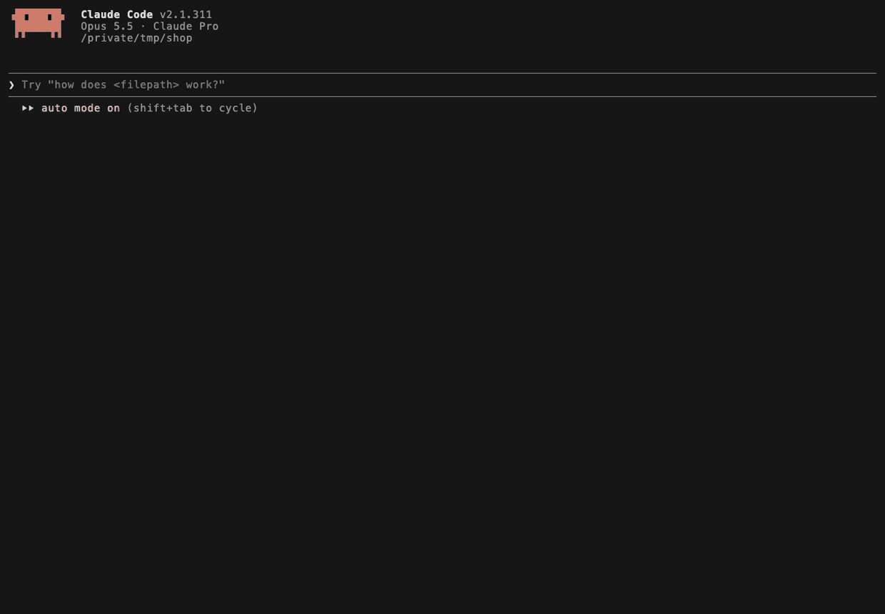

# TrueQuery

[](https://github.com/Analytically-ai/truequery/actions/workflows/ci.yml)

**One standard for data work, built into your AI coding agent.**

TrueQuery gives AI coding agents, and the data engineers, analytics
engineers, BI engineers and analysts who work with them, one standard for
how data work gets done: how pipelines and models are built, how SQL is
written, how metrics are defined, and how the result is verified. A skill
teaches the agent the procedure. A deterministic, offline checker verifies
the work as it's written.

> **Quick start (Claude Code):** `claude plugin marketplace add Analytically-ai/truequery`,
> then `claude plugin install truequery@analytically`, then run
> `/truequery init` inside your project.
>
> **Status: preview (0.1).** Runs in Claude Code today, with more agents
> on the [roadmap](#roadmap). What we've measured, and what we haven't:
> [evidence and limits](docs/evidence.md). Feedback and bug reports are
> welcome in [issues](https://github.com/Analytically-ai/truequery/issues).

## See it work

There are two ways to run TrueQuery: the `/truequery` skill inside Claude
Code, where the agent does the work, and the `truequery` checker on its own
in a terminal or CI.

### In Claude Code: `/truequery review`

A real session on the demo shop, reviewing one dbt model (sped up; it pauses
on the checker's receipt and again on the recommendation). The
agent runs the checker, reads everything the model depends on, checks each
house definition against the code, confirms suspected bugs in the data, and
ends with a merge recommendation.



### In Claude Code: `/truequery ask`

In a run on the demo shop in October 2026,
`/truequery ask how much money did we make last month?` answered:

> **About $8,863 in March 2025**
>
> Revenue for March 2025 was $8,862.88 (US dollars). That's money from 20
> completed, paid orders placed by 19 customers. No refunds were processed
> against those orders.
>
> Why March 2025 and not last month: today is October 2026, but the shop's
> records stop on 24 April 2025. September 2026 has no data, so I used the
> most recent full month.

### In a terminal or CI: `truequery review`

The checker on its own, with no agent: the same command the skill runs under
the hood. Offline and deterministic, with the receipt at the end.


## Run it on your own repo

- In Claude Code: `/truequery init` in your project, then
  `/truequery review models/` (or any SQL folder).
- Checker only, no install: `uvx truequery detect path/to/sql/`
- Install: `pip install truequery` or `uv tool install truequery`
- Hit a false alarm?
  [Report it](https://github.com/Analytically-ai/truequery/issues/new?template=false_alarm.yml).
  It's the most useful feedback we can get.

## Why TrueQuery?

Ask an AI agent to "build a pipeline for the refunds data" and you get code
that runs. You also get revenue that counts deleted accounts, a model with
no stated grain, no tests, a metric made up on the spot, and nothing that
tells you what was checked. Ask again tomorrow and you get a different
answer. The model is capable. It's working without your definitions and
without a standard.

Today's fixes don't hold up. Senior engineers review everything by hand,
or the model is asked to check its own work: slow, expensive, and blind in
exactly the same places. And the problems surface in review or in
production instead of while the code is being written.

TrueQuery moves the standard into the loop where the work happens:

- **The agent follows one procedure**, whoever asks and however vaguely.
- **The checks are deterministic.** Plain code, not a model re-reading its
  own output: the same input gets the same answer every time, in
  well under a second per file, offline.
- **Problems are caught at write time.** Findings go back to the agent
  before it says it's done.

## How it works

Every command follows one flow. It reads the repo, your definitions and the
schema first, then asks only what it can't find out: at most 5 questions,
each with a recommended default. It writes the contract (grain, keys,
columns with units, freshness, owner) before any code. It builds in your
project's own stack (dbt, Airflow, Dagster, plain SQL, pandas) with tests it
actually runs, then checks the result. It ends with a **receipt**: what was
built, what was checked, and **what was not checked, and why**. Your answers
go into `DATA.md` and the contracts, so nobody is asked twice.

**Your definitions win.** If a request contradicts how your team defines a
number, say "average order value" over a column stored in cents,
TrueQuery says so before writing anything. It follows your definition
unless you confirm otherwise, and records the decision.

**Where the standard comes from.** TrueQuery ships 220 practices the
industry has converged on: dimensional modeling, warehouse storage and
performance, dbt conventions, data quality, governance and operations. Your
team's own conventions layer on top through `/truequery init`, `DATA.md` and
per-table contracts. A team without a veteran modeler still builds to the
standard, and a mature team gets its own house rules enforced.

## Commands

Run them in your agent session, or just describe the task: the skill picks
it up on its own.

| Command | For | What it does |
|---|---|---|
| `/truequery init` | everyone | One-time setup: detects your stack, asks a few questions about your house definitions, writes `DATA.md` |
| `/truequery build …` | data and analytics engineers | Build a pipeline, load or model end to end: contract, code, tests, checks, receipt |
| `/truequery ask …` | non-technical users | A plain-English answer with how sure it is; the SQL sits under "How I got this" |
| `/truequery analyze …` | analysts | Answer a data question to the standard, with sanity checks and caveats |
| `/truequery metric "…"` | BI engineers | Define a metric once; `metric check …` finds every place that computes it differently |
| `/truequery review` | everyone | Run every check, then the receipt and a critique of what checks can't see |
| `/truequery harden …` | engineers | Make a model or load production-ready: idempotency, late data, schema changes, NULL and edge guards |
| `/truequery hooks on\|off\|status` | everyone | Show or set up per-edit checks (with the plugin they're on already; to stop them, disable the plugin) |

## The checker

Underneath the skill, the checker (`truequery`, short alias `tq`) looks for
SQL that silently returns the wrong answer. On the demo file
`samples/bad_orders.sql`:

```
$ truequery detect samples/bad_orders.sql
samples/bad_orders.sql:7:19 [error] sql/accidental-cross-join — no predicate links o: every row pairs with every row on the other side
    fix: add ON <keys>, or CROSS JOIN if cartesian is intended
samples/bad_orders.sql:13:7 [error] sql/not-in-nullable-subquery — a NULL in the subquery makes NOT IN return zero rows
    fix: rewrite as NOT EXISTS, or add WHERE col IS NOT NULL
samples/bad_orders.sql:17:14 [error] sql/count-star-after-left-join — COUNT(*) over an outer join counts 1 for unmatched rows
    fix: count the nullable-side key instead, e.g. COUNT(o.<key>)
...
5 errors, 2 warnings in 1 file checked offline
```

`truequery review` adds the receipt. Its `Not checked` lines are the
point: they name what this pass could not verify. Here that's the data
itself; a limit such as integer division is listed only when a file
could hit it.

```
TrueQuery receipt
Checked      1 SQL file · contracts for 0 of 3 tables
Found        5 errors · 2 warnings
Not checked  your data: TrueQuery reads files and never connects to your database
No contract  customers, orders, staging_orders
```

- **Offline and deterministic.** No LLM in the check path and no network
  calls. Your code never leaves your machine.
- **Never a false "clean".** A file it couldn't parse is listed as not
  checked, and the exit code says so. SQL embedded in Python files is
  reported as not checked yet.
- **Runs as the agent works.** Hooks check each SQL edit for bugs that are
  never intended (`= NULL`, an unguarded `DELETE`, a `WHERE` that empties a
  left join). At the end of each turn they run every enabled check over the
  files touched. New findings go back to the agent once, a clean pass is
  silent, and no edit is ever refused.
- **Works anywhere SQL lives.** In a terminal and in CI, for any agent or
  person: text, JSON or SARIF output. Exit codes: 0 means clean; 1 means
  findings at or above `--fail-on` (default `error`); 2 is a usage or config
  error; 3 means some files couldn't be checked (`--allow-unverified` turns
  3 into 0).

## How it fits with your tools

TrueQuery isn't an orchestrator, warehouse or catalog, and it doesn't ask
you to change your stack. It sits alongside what you already use:

- **SQLFluff** checks style and layout. TrueQuery checks whether the data
  logic is right. Use both.
- **dbt tests** check the data after a model is built. TrueQuery makes the
  agent write those tests in the first place, and checks the model's code
  while it's being written.
- **Great Expectations and Soda** run the data-quality checks you define.
  TrueQuery standardizes everything around them: how the work is built,
  documented and reviewed, not only how it's tested.
- **Observability tools** (Monte Carlo, Bigeye, Metaplane) watch production
  data. TrueQuery works before production, so less slips through for them
  to catch.

## Works with

| Where | Status |
|---|---|
| Claude Code | Supported: skill, commands, hooks (on Windows the per-edit hooks need [Git for Windows](https://git-scm.com/download/win), which provides Git Bash) |
| Terminal and CI (any agent, any person) | Supported: `truequery detect` / `review`, JSON and SARIF |
| Codex, Muse Code | Hook configs included (`truequery install --harness codex\|muse`), not yet verified live |
| Cursor, GitHub Copilot, Gemini CLI and others | Planned |

## Install

Needs [Claude Code](https://claude.com/claude-code) and
[uv](https://docs.astral.sh/uv/) (Python 3.11+).

```bash
claude plugin marketplace add Analytically-ai/truequery
claude plugin install truequery@analytically
```

Then open your project in Claude Code and run `/truequery init`.

The checker ships inside the plugin: the hooks and the agent always run
the version that matches the plugin, with nothing else to install. To use
`truequery` in a terminal or in CI:

```bash
pip install truequery          # or: uv tool install truequery
```

That installs `truequery` and the short alias `tq`. If another tool in the
same environment already provides a `tq` command, use `truequery`. Contributors working from a
clone can install the local engine instead, from the repo root:

```bash
uv tool install ./plugin/engine
```

**Stay up to date.** TrueQuery is moving fast, and Claude Code doesn't
auto-update third-party plugins unless you ask it to. Turn it on under
`/plugin` → Marketplaces → analytically → Enable auto-update, or update by
hand with `claude plugin update truequery@analytically`, then
`/reload-plugins`. `/truequery init` explains this, and for a shared repo
offers to turn on auto-update for the whole team.

## You control the rules

Every rule can be switched on or off, moved between the per-edit and
end-of-turn checks, or given a different severity: per project in
`DATA.md`, or for yourself in `~/.config/truequery/config.yaml`.

```bash
truequery rules                             # what's on, and where each setting came from
truequery rules sql/accidental-cross-join   # one rule: what it means, with a proof
truequery rules set sql/between-date-on-timestamp --enabled off
```

Agents never change rule settings: the skill forbids it, and if settings
change during a session, the agent is told to check with you. An agent may
only ignore a single line, and must give a reason
(`truequery ignore add <rule> <path:line> --reason "..."`). Every rule
earns its place on precision: one that misfires gets fixed or switched off
by default.

### All 25 checks

`immediate` checks run after every edit; `stop` checks run at the end of the
turn. Checks that are off by default aren't yet precise enough to run
unasked; switch them on with `truequery rules set`.

| Rule | Default | Build severity | What it catches |
|---|---|---|---|
| `dq/uniqueness-key-no-duplicates` | off (stop) | error | Declared keys carry a zero-duplicate uniqueness check |
| `ingest/declare-source-freshness` | off (stop) | warning | Every ingested source declares a freshness threshold |
| `model/unique-key-merge-key` | on (stop) | error | Incremental merge models declare a non-null unique merge key |
| `orch/explicit-catchup-policy` | off (stop) | warning | Scheduled DAGs set catchup explicitly |
| `sql/accidental-cross-join` | on (stop) | error | Every join of two tables carries an explicit join predicate |
| `sql/average-of-ratios` | off (stop) | warning | Aggregate a ratio as SUM(numerator) / SUM(denominator), not AVG of row ratios |
| `sql/between-date-on-timestamp` | on (stop) | warning | Filter timestamps with a half-open range, not BETWEEN date literals |
| `sql/case-without-else-in-aggregate` | on (stop) | advisory | A CASE that feeds arithmetic or an aggregate states its ELSE |
| `sql/count-star-after-left-join` | on (stop) | error | Count child rows with COUNT(child.key), not COUNT(*), after a LEFT JOIN |
| `sql/distinct-dedup-bandaid` | off (stop) | warning | SELECT DISTINCT never stands in for a grain fix |
| `sql/group-by-bare-column` | on (stop) | warning | In engines that allow it, GROUP BY queries never project bare ungrouped columns |
| `sql/insert-explicit-column-list` | on (stop) | warning | INSERT INTO names its target columns |
| `sql/integer-division-truncation` | on (stop) | warning | Divide integers only after casting to a non-integer type |
| `sql/keyset-pagination` | off (stop) | warning | Paginated reads use keyset seeks, not OFFSET |
| `sql/left-join-null-rejecting-where` | on (immediate) | warning | Filters on the nullable side of an outer join live in ON |
| `sql/limit-requires-order-by` | off (stop) | warning | Every LIMIT carries an ORDER BY |
| `sql/natural-join-explicit-keys` | on (stop) | warning | Joins name their keys explicitly, never NATURAL JOIN |
| `sql/negative-filter-drops-nulls` | off (stop) | warning | Negative filters on nullable columns state what happens to NULLs |
| `sql/nondeterministic-merge-keys` | on (stop) | error | Merge and dedupe keys never use nondeterministic functions |
| `sql/not-in-nullable-subquery` | on (stop) | error | NOT IN is never used against a nullable subquery |
| `sql/null-equality-comparison` | on (immediate) | error | Test for NULL with IS NULL, never with = NULL or <> NULL |
| `sql/row-number-dedupe-tiebreaker` | on (stop) | warning | ROW_NUMBER dedupe orders by a unique tiebreaker |
| `sql/set-operation-column-position` | off (stop) | error | Set-operation branches align columns explicitly by position |
| `sql/unguarded-update-delete` | on (immediate) | error | UPDATE and DELETE always carry a filter or an explicit full-table guard |
| `sql/union-all-default` | off (stop) | warning | Bare UNION states its dedup intent; UNION ALL is the default for appends |

## The standard

220 practices for data work, across 9 lifecycle domains (ingest, store,
model, orchestrate, data quality, semantics and metrics, consumption,
governance, operations) and 2 cross-cutting packs (SQL, Python). Each one
is a record with its rationale, examples and sources. The skill teaches all
of them; the checker enforces only the ones a file can prove.
`truequery rules --all` lists them.

## Roadmap

TrueQuery starts where agents write data code and grows to cover the whole
data lifecycle, from first draft to production.

**Now: preview (0.1)**
- The skill with 8 commands, the receipt, house definitions and contracts.
- 25 offline checks (15 on by default) with hooks in Claude Code.
- Terminal and CI use, with JSON and SARIF output.
- What we've measured so far, and what we haven't:
  [evidence and limits](docs/evidence.md).

**Next**
- **More agents:** Codex and Muse Code verified live, then Cursor, GitHub
  Copilot, Gemini CLI and others, with one installer that sets up whichever
  you use.
- **CI integrations:** a GitHub Action and a pre-commit hook.
- **More checks**, each promoted only when it proves precise on real
  projects: join fan-out, partition filters, `SELECT *` in production
  models, incremental watermarks.

**Later**
- **The rest of the lifecycle as full commands:** a standard six-dimension
  data-quality suite (`dq`), migrations and backfills (`change`),
  documentation kept in sync with the code (`document`), cost and
  performance (`optimize`), and dialect porting (`adapt`).
- **Read-only warehouse connections**, starting with BigQuery dry runs, then
  Snowflake and Databricks: profiling, drift and cost estimates, so the
  receipt can say "checked against the data". Calls go from your machine
  to your warehouse only; your data never reaches us.
- **Team-wide standards:** your company's rules and definitions, shared
  with every developer's agent.

## Try it on the demo shop

`examples/shop/` is a small synthetic online shop: a DuckDB warehouse and a
dbt project, with house definitions and the messy data real teams have.
[`docs/try-the-demo.md`](docs/try-the-demo.md) has a prompt for each role
and what a good answer looks like.

## FAQ

**Why not just put these rules in CLAUDE.md?**
Instructions in CLAUDE.md are a good start, but nothing checks that the
agent followed them, and an agent reviewing its own work is blind in the
same places as its first draft. TrueQuery gives the agent a full procedure
and 220 sourced practices, then backs them with a deterministic checker
that runs on every edit and a receipt that says what wasn't verified. It
works alongside your CLAUDE.md; your house definitions go in `DATA.md`.

**Why not just run SQLFluff?**
SQLFluff checks style and layout. TrueQuery checks whether the logic
returns the right answer: a `NOT IN` that one NULL empties, a `WHERE` that
turns a `LEFT JOIN` into an inner join, a `COUNT(*)` that counts missing
rows. They don't overlap, so use both.

**What does it cost in tokens?**
A little more. On 10 vague, realistic requests, TrueQuery cost about 19% more
than plain Claude Code in tokens, and made no silent mistakes where plain
Claude Code made three. The checker itself uses no tokens: it's plain code running
on your machine. See [Evidence and limits](docs/evidence.md).

**Which SQL dialects does the checker handle?**
It parses SQL with [sqlglot](https://github.com/tobymao/sqlglot). Tested on
real code: BigQuery, PostgreSQL and DuckDB. Tested on synthetic workloads:
Snowflake, Redshift and SQLite. Databricks and Spark, T-SQL, MySQL, Trino
and sqlglot's other dialects are parsed too, with less test coverage, so
false alarms there are especially welcome. `/truequery init` detects the
dialect from your dbt or SQLMesh config. You can also set it in `DATA.md`
or with `--dialect`. A file that doesn't parse is reported as not
checked, never as clean.

**What do I do about a false alarm?**
1. [Report it](https://github.com/Analytically-ai/truequery/issues/new?template=false_alarm.yml). It's the most useful feedback we get.
2. Ignore one line, with a reason:
   `truequery ignore add <rule> <path:line> --reason "..."`
3. Or switch the rule off for the project:
   `truequery rules set <rule> --enabled off` (add `--scope user` to
   switch it off just for you).

**Does my code or data leave my machine?**
The checker makes no network calls and sends no telemetry. Claude Code
still talks to its model provider as it always does, and TrueQuery doesn't
change that. TrueQuery never connects to your warehouse.

## Contributing

See [`CONTRIBUTING.md`](CONTRIBUTING.md) for setup, tests and the
repository layout.

## License

Apache-2.0. See [`LICENSE`](LICENSE) and [`NOTICE`](NOTICE).

TrueQuery is built by Analytically.ai.
