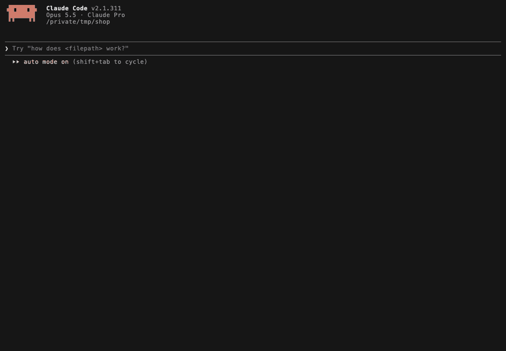

<p align="center">
  <picture>
    <source media="(prefers-color-scheme: dark)" srcset="docs/assets/truequery-logo-dark.svg">
    
  </picture>
</p>

<p align="center">
  <a href="https://github.com/Analytically-ai/truequery/actions/workflows/ci.yml"></a>
  <a href="https://pypi.org/project/truequery/"></a>
  <a href="LICENSE"></a>
</p>

## From "it ran" to "it's right."

AI agents write data code that runs without errors. That doesn't mean the
numbers are right. TrueQuery holds the agent to your team's definitions,
checks its work with plain code, and tells you exactly what it checked and
what it didn't.

One tool for every coding agent: **Claude Code** and **Muse Code** today,
**Gemini CLI** and **Codex** next, then **Cursor** and **GitHub Copilot**.
The checker runs anywhere: any terminal, any CI, any agent.
[Install for your agent →](#install)

## One question, two answers

Someone at an online shop asks their agent: **"how much money did we make
last month?"** Same agent (Claude Code), same model, same data, two real
runs:

| Without TrueQuery | With TrueQuery |
|---|---|
| "**March 2025 revenue was $9,452.79**, from 21 orders." | "The most recent full month in the data is **March 2025: $8,862.88 in revenue** from 20 orders." |
| Wrong. It caught the deleted accounts, but the warehouse cuts days in Los Angeles time while the shop counts days in UTC, so orders landed in the wrong month. The answer gives no hint of it. | Right, matching the answer key written before either run. It also warned that the shop's own revenue report is about $3,000 too high, and why. |

Both answers read well, and the agent without TrueQuery even caught one
trap. It missed the one hidden in the build script. Here's how TrueQuery got
it right.

**1. It learned the shop's definitions first.** When the project was set up,
`/truequery init` read the code and the data, then asked a few questions:
what counts as revenue, which accounts are tests, how money is stored, which
date an order belongs to. It wrote the answers into `DATA.md`, including a
trap it found on the way (excerpt, trimmed):

```markdown
- **Business date**: order day = `ordered_at` truncated to the **UTC** day.

1. **Timezone**: `build_marts.py` sets `TimeZone='America/Los_Angeles'` [...]
   872 of 2,571 orders (34%) land on the wrong day.
```

**2. It follows those definitions on every request,** whoever asks and
however vaguely. Nobody is asked the same question twice. If a request
contradicts a definition (say, averaging a column that's stored in cents),
it says so before writing anything, follows the definition unless you
confirm otherwise, and records the decision.

**3. It checks the SQL with plain code as it's written.** The time-zone trap
was caught by the definitions. The checker catches a different kind of
mistake: SQL that runs without errors and still returns the wrong answer. It
looks for 25 kinds of it, offline and with no AI involved, while the agent
works:

```sql
-- Customers who never ordered
SELECT id FROM customers
WHERE id NOT IN (SELECT customer_id FROM orders);
```
```
samples/bad_orders.sql:13:7 [error] sql/not-in-nullable-subquery — a NULL in the subquery makes NOT IN return zero rows
    fix: rewrite as NOT EXISTS, or add WHERE col IS NOT NULL
```

One order with no customer, and the query returns no one, even though some
customers never ordered.

**4. It ends with a receipt.** Every task says what was checked, what was
found and, just as plainly, what wasn't checked. On the full sample file:

```
TrueQuery receipt
Checked      1 SQL file · contracts for 0 of 3 tables
Found        5 errors · 2 warnings
Not checked  your data: TrueQuery reads files and never connects to your database
No contract  customers, orders, staging_orders
```

In an answer for a person, it says the same thing in plain words. From the
revenue answer above:

> These are from my own queries against `warehouse.duckdb`. The TrueQuery
> checker only inspects code, so it didn't check these figures.

## What you can do with it

Ask in your own words; TrueQuery picks up the task. A few examples:

- **"How much did we make last month?"** Anyone can ask, no SQL needed. You
  get a plain-English answer, how sure it is, and which definition it used.
- **"Build a daily refunds table."** For data engineers: a contract first
  (one row per what, which keys, which units), then the code in your own
  stack, then tests it actually runs. In the benchmark it reported:
  > I built `fct_refunds_daily`: one row per UTC refund day, 479 days from
  > 2024-01-12 to 2025-05-04 with no gaps, and refund amounts in USD. [...]
  > five SQL checks pass whether the session runs in UTC or LA time.
- **"Two teams compute churn differently."** For BI and analytics leads:
  record one definition, then find the places that compute it differently,
  each difference named instead of silently replaced.
- **"Review this before I merge."** For reviewers: every check, your team's
  definitions compared with the code, suspected bugs confirmed in the data,
  and a merge recommendation:

  

- **"Fail CI on SQL that returns wrong answers."** For platform teams: the
  checker on its own, in any terminal or CI.

## Commands

Run them in your agent (in Claude Code they're `/truequery` slash
commands; in Muse Code, load the skill with `/skill truequery`), or just
describe the task. Every command follows one procedure:
read the repo and your definitions first, ask only what it can't find out
(at most 5 questions, each with a suggested default), write the contract
before the code, check the result, end with a receipt, and remember the
answers.

| Command | For | What it does |
|---|---|---|
| `/truequery init` | everyone | One-time setup: detects your stack, asks a few questions about your team's definitions, writes `DATA.md` |
| `/truequery build …` | data and analytics engineers | Build a pipeline, load or model end to end: contract, code, tests, checks, receipt |
| `/truequery ask …` | anyone, no SQL needed | A plain-English answer with how sure it is and which definition it used; the SQL sits under "How I got this" |
| `/truequery analyze …` | analysts | Answer a data question to the standard, with sanity checks and caveats |
| `/truequery metric "…"` | BI engineers | Define a metric once; `metric check …` looks for places that compute it differently and names each difference |
| `/truequery review` | everyone | Run every check, then the receipt and a critique of what checks can't see |
| `/truequery harden …` | engineers | Make a model or load production-ready: idempotency, late data, schema changes, NULL and edge guards |
| `/truequery hooks on\|off\|status` | everyone | Show or set up the checks that run as the agent edits |

`model`, `ingest` and `orchestrate` also work: they start `build` with that
intent.

## The checker

Underneath the commands, the checker (`truequery`, short alias `tq`) reads
your code and looks for SQL that silently returns the wrong answer. You can
also run it on its own.

- **Offline and deterministic.** No LLM in the check path and no network
  calls. Your code never leaves your machine.
- **Never a false "clean".** A file it couldn't parse, or a query it could
  read only as an opaque command, is listed as not checked, and the exit
  code says so.
- **Checks the SQL inside Python too.** SQL strings passed to `execute`,
  `read_sql`, `text()`, `.sql()` or `sql=` (including f-strings,
  `.format()`, `%` and a query held in a same-file variable) get the same
  checks as `.sql` files, and findings point at the Python line and column.
  SQL your program builds at run time can't be read from the file: it's
  listed as not checked, never as clean.
- **Runs as the agent works.** Each edit to a SQL file (or a Python file
  with SQL inside) is checked for bugs that are never intended (`= NULL`, an
  unguarded `DELETE`, a `WHERE` that empties a left join). At the end of
  each turn, every enabled check runs over the files touched. New findings
  go back to the agent once, a clean pass is silent, and no edit is ever
  refused.
- **Works anywhere SQL lives.** In a terminal and in CI, for any agent or
  person: text, JSON or SARIF output. Exit codes: 0 means clean; 1 means
  findings at or above `--fail-on` (default `error`); 2 is a usage or config
  error; 3 means some files couldn't be checked (`--allow-unverified` turns
  3 into 0).

All 25 checks, with what each one catches: [the checker in
detail](docs/checker.md).

## You control the rules

Every rule can be switched on or off, moved between the per-edit and
end-of-turn checks, or given a different severity: per project in
`DATA.md`, or for yourself in `~/.config/truequery/config.yaml`.

```bash
truequery rules                             # what's on, and where each setting came from
truequery rules sql/accidental-cross-join   # one rule: what it means, with a proof
truequery rules set sql/between-date-on-timestamp --enabled off
```

Agents never change rule settings: the skill forbids it, and if settings
change during a session, the agent is told to check with you. An agent may
only ignore a single line, and must give a reason
(`truequery ignore add <rule> <path:line> --reason "..."`). Every rule
earns its place on precision: one that misfires gets fixed or switched off
by default.

## The proof

- **Vague requests, graded blind.** 10 everyday requests on a demo shop and
  a real bank dataset: Claude Code without TrueQuery gave **3 silently
  wrong answers**. With TrueQuery: **0**, for about 19% more tokens.
- **Real code.** We ran the checker over 10 SQL projects and 12 public
  Python projects (Apache Superset, PostHog, Zulip, Apache Airflow's DAGs
  and more) and labelled every finding by hand. All 279 findings in the
  Python projects are accurate: the first run's 6 false alarms, from three
  rules, were fixed in 0.1.3.
- **Built to be checked.** Open source, offline and deterministic: the same
  input gets the same answer every time.

Every number, with how it was measured: [Evidence and limits](docs/evidence.md).

## When definitions disagree

Your definitions are the source of truth, and TrueQuery treats them that way:

- **A request that contradicts a definition:** the agent says so before
  writing anything, follows the definition unless you confirm otherwise, and
  records the decision.
- **Two computations of the same metric:** `metric check` names each one
  and how it differs. TrueQuery doesn't pick a winner: you decide, and the
  decision goes into `DATA.md`, so nobody is asked again.
- **Code or data that breaks a definition:** it's flagged, the way `init`
  caught the warehouse running on Los Angeles time when the shop counts days
  in UTC.
- **A definition that's out of date:** no code can reveal that, so answers
  state the definition behind each number, and the receipt lists every
  assumption. The person asking can always see what a number means.

## Install

TrueQuery needs [uv](https://docs.astral.sh/uv/) (Python 3.11+). Pick your
agent:

| Agent | What you get | Status |
|---|---|---|
| **Claude Code**, **Muse Code** | The full skill, all commands, checks on every edit and at the end of each turn | Ready |
| **Codex** | Checks as the agent works, being verified live; the full skill next | Early access |
| **Gemini CLI** | The full skill and checks | Coming next |
| **Cursor**, **GitHub Copilot** | The full skill and checks | Planned |
| **Any agent, terminal or CI** | The checker on its own: text, JSON or SARIF | Ready |

Claude Code and Muse Code install the same plugin, with the same skill and
checks.

### Claude Code

```bash
claude plugin marketplace add Analytically-ai/truequery
claude plugin install truequery@analytically
```

Open your project in Claude Code and run `/truequery init`, then try
`/truequery review models/` (or any folder of SQL). On Windows, the
per-edit checks also need [Git for Windows](https://git-scm.com/download/win).

**Stay up to date:** Claude Code doesn't auto-update third-party plugins
unless you ask. Turn it on under `/plugin` → Marketplaces → analytically →
Enable auto-update, or run `claude plugin update truequery@analytically`
and then `/reload-plugins`. `/truequery init` explains this, and for a
shared repo offers to turn on auto-update for the whole team.

### Muse Code

```bash
muse plugins marketplace add analytically https://github.com/Analytically-ai/truequery
muse plugins install truequery@analytically
muse plugins approve truequery
```

The last line approves the plugin's checks, once (Muse asks again only when
they change). Then ask for data work in your own words, or load the skill
with `/skill truequery`. The checks also cover SQL the agent writes from the
shell (`cat > q.sql`, `… | tee q.sql`). If the skill can't find `truequery`
on your PATH, install it with `pip install truequery`.

**Stay up to date:** `muse plugins marketplace update analytically`, then
`muse plugins update truequery`.

### Codex (early access)

```bash
pip install truequery          # or: uv tool install truequery
truequery install --harness codex
```

This sets up the checks as the agent works (being verified live). Approve
them once in Codex with `/hooks`. The full skill (the procedure, the
commands and `init`) is coming next.

### Any agent, terminal or CI

```bash
pip install truequery          # or: uv tool install truequery
truequery detect path/to/code/       # findings
truequery review path/to/code/       # findings plus the receipt
uvx truequery detect path/to/code/   # or run it without installing
```

That installs `truequery` and the short alias `tq`.

**pre-commit:** add TrueQuery to `.pre-commit-config.yaml` (`truequery` checks staged `.sql` files; `truequery-python` checks `.sql` and `.py`):

```yaml
repos:
  - repo: https://github.com/Analytically-ai/truequery
    rev: v0.1.5
    hooks:
      - id: truequery
```

**GitHub Actions:** run `uses: Analytically-ai/truequery@v0.1.5` to check pull requests and write the receipt to the job summary. Full options and SARIF setup: [`docs/ci-and-pre-commit.md`](docs/ci-and-pre-commit.md).

### Try it on the demo shop

`examples/shop/` is the shop from the story above: a DuckDB warehouse and a
dbt project, with the messy data real teams have.
[`docs/try-the-demo.md`](docs/try-the-demo.md) has a prompt for each role
and what a good answer looks like.

## How it fits with your tools

TrueQuery isn't an orchestrator, warehouse or catalog, and it doesn't ask
you to change your stack. It sits alongside what you already use:

- **SQLFluff** checks style and layout. TrueQuery checks whether the data
  logic is right. Use both.
- **dbt tests** check the data after a model is built. TrueQuery makes the
  agent write those tests in the first place, and checks the model's code
  while it's being written.
- **Great Expectations and Soda** run the data-quality checks you define.
  TrueQuery standardizes everything around them: how the work is built,
  documented and reviewed, not only how it's tested.
- **Observability tools** (Monte Carlo, Bigeye, Metaplane) watch production
  data. TrueQuery works before production, so less slips through for them
  to catch.

## The standard

220 practices for data work, across 9 lifecycle domains (ingest, store,
model, orchestrate, data quality, semantics and metrics, consumption,
governance, operations) and 2 cross-cutting packs (SQL, Python). Each one
is a record with its rationale, examples and sources. The skill teaches all
of them; the checker enforces only the ones a file can prove.
`truequery rules --all` lists them. Your team's own conventions layer on
top through `/truequery init`, `DATA.md` and per-table contracts.

## FAQ

**Why not just put these rules in CLAUDE.md or AGENTS.md?**
Instructions are a good start, but nothing checks that the agent followed
them, and an agent reviewing its own work is blind in the same places as its
first draft. TrueQuery gives the agent a full procedure and 220 sourced
practices, then backs them with a deterministic checker and a receipt that
says what wasn't verified. Your team's definitions go in `DATA.md`.

**What does it cost in tokens?**
A little more. On 10 vague, realistic requests, TrueQuery cost about 19%
more than Claude Code on its own, and made no silent mistakes where Claude
Code alone made three. The checker itself uses no tokens: it's plain code
running on your machine.

**Does my code or data leave my machine?**
The checker makes no network calls and sends no telemetry. Your agent still
talks to its model provider as it always does, and TrueQuery doesn't change
that. TrueQuery never connects to your warehouse.

More answers (SQLFluff, dialects, false alarms): [FAQ](docs/faq.md).

## Roadmap

- **Next:** the full skill in Gemini CLI and Codex, then Cursor and GitHub
  Copilot; checks for pandas pipelines.
- **Later:** read-only checks against your data (local files first, then
  warehouses), so the receipt can say "checked against the data"; the rest
  of the lifecycle as full commands (data quality, migrations and backfills,
  docs kept in sync, cost); and team-wide definitions shared with every
  developer's agent.

## Contributing

Found a false alarm?
[Report it](https://github.com/Analytically-ai/truequery/issues/new?template=false_alarm.yml):
it's the most useful feedback we get. For setup, tests and the repository
layout, see [`CONTRIBUTING.md`](CONTRIBUTING.md).

## License

Apache-2.0. See [`LICENSE`](LICENSE) and [`NOTICE`](NOTICE).

TrueQuery is built by Analytically.ai.
